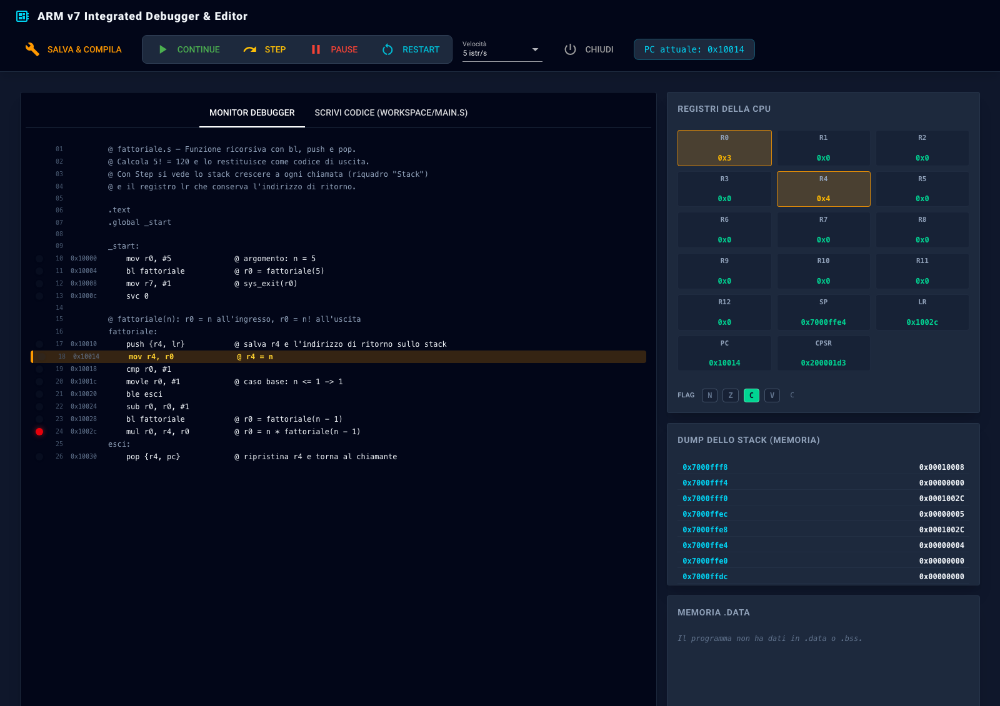
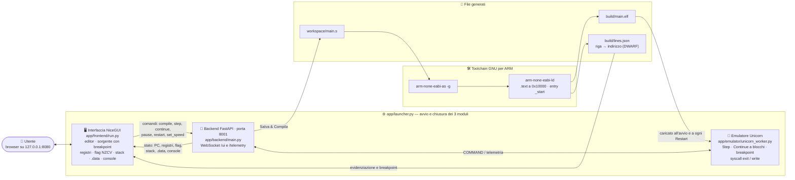

# ARM-GDK-Unicorn

🇬🇧 [English](README.md) · 🇮🇹 **Italiano**

<p align="center"></p>

**Un ambiente didattico per scrivere, eseguire e fare il debug di programmi in assembly ARMv7, direttamente nel browser.** Si scrive il codice con la sintassi GNU usata nei corsi di Architettura dei calcolatori, lo si compila con la vera toolchain GNU per ARM e lo si esegue istruzione per istruzione in un emulatore della CPU, guardando registri, flag, stack e memoria cambiare a ogni passo.

<p align="center"></p>

## Caratteristiche

- **Editor e compilazione dal browser**: *Salva & Compila* assembla il codice con `arm-none-eabi-as` e `arm-none-eabi-ld` e lo carica subito nell'emulatore. Gli errori compaiono in console con il numero di riga.
- **Esecuzione passo passo (Step)** ed **esecuzione continua (Continue)** con velocità regolabile, da 1 istruzione al secondo, per seguire il programma riga per riga, fino alla velocità massima.
- **Breakpoint** con un clic accanto alla riga: l'esecuzione si ferma *prima* dell'istruzione marcata.
- **Registri** r0–r12, sp, lr, pc e cpsr, con evidenziati quelli usati dall'istruzione corrente.
- **Flag N Z C V** del CPSR, con la spiegazione di ciascuno.
- **Stack** intorno a SP e **memoria `.data`/`.bss`** con le etichette del programma, il valore e i caratteri ASCII.
- **Chiamate di sistema Linux** `exit` e `write`, con l'output del programma in console.
- **Esempi pronti** in [`examples/`](examples/): cicli, array, funzioni ricorsive, stringhe e flag.
- **Funziona su Windows, macOS e Linux**, verificato a ogni modifica da GitHub Actions.

## Avvio rapido

### 1. Requisiti

- **Python 3.11** o successivo.
- **La toolchain GNU per ARM**: servono solo `arm-none-eabi-as` e `arm-none-eabi-ld`.

| Sistema | Installazione della toolchain |
| ------- | ----------------------------- |
| Windows | [Arm GNU Toolchain](https://developer.arm.com/downloads/-/arm-gnu-toolchain-downloads), versione *arm-none-eabi* per host Windows; durante l'installazione spunta *Add path to environment variable* |
| macOS   | `brew install arm-none-eabi-binutils` |
| Linux   | `sudo apt install binutils-arm-none-eabi` (Debian, Ubuntu) oppure il pacchetto equivalente della distribuzione |

Se la toolchain è in una cartella non standard, indica la sua cartella `bin` nella variabile d'ambiente `ARM_TOOLCHAIN_DIR`.

### 2. Avvio

```bash
./start.sh        # macOS e Linux
start.bat         # Windows
```

Al primo avvio lo script crea un ambiente virtuale Python, installa le dipendenze fissate in `requirements.txt` e controlla che la toolchain ci sia. Se manca, spiega come installarla e si ferma. Poi avvia i tre moduli nella stessa finestra e apre il browser su <http://127.0.0.1:8080>.

### 3. Chiusura

Si chiude tutto insieme in uno di questi modi:
- con il pulsante **Chiudi** nell'interfaccia;
- con **Ctrl+C**;
- chiudendo la finestra del terminale.

Se uno dei moduli si ferma per un errore, il lanciatore chiude anche gli altri.

## Come si usa

1. **Scrivi** il programma nella scheda *Scrivi codice*. Finché non salvi compare **● Modifiche non salvate**.
2. Premi **Salva & Compila**. Se la compilazione va a buon fine, il programma viene caricato nell'emulatore e riparte dall'inizio. Continue, Step e Restart non ricompilano: eseguono sempre l'ultima versione compilata, e avvisano se l'editor ha modifiche non salvate.
3. **Esegui** con *Step* o con *Continue*, scegliendo la velocità nel menu *Velocità*. *Pause* sospende, *Restart* riporta il programma all'inizio.
4. **Osserva** la riga corrente nella scheda *Monitor*, i registri, i flag, lo stack, la memoria `.data` e la console.

Il programma termina con la chiamata di sistema `exit`. Dopo `exit` non viene eseguita nessun'altra istruzione fino a *Restart*.

Si possono aprire più schede del browser sullo stesso debugger: mostrano tutte lo stesso stato.

## Esempi

| File | Cosa mostra | Risultato |
| ---- | ----------- | --------- |
| [`hello.s`](examples/hello.s) | `write` ed `exit`, costante calcolata `len = . - msg` | stampa una stringa |
| [`somma.s`](examples/somma.s) | ciclo con contatore, `cmp` e `ble` | `exit(55)`: somma da 1 a 10 |
| [`massimo.s`](examples/massimo.s) | array con `.word`, post-incremento, istruzioni condizionate (`movgt`) | `exit(42)`: massimo dell'array |
| [`fattoriale.s`](examples/fattoriale.s) | funzione ricorsiva con `bl`, `push` e `pop`; lo stack che cresce | `exit(120)`: 5! |
| [`lunghezza.s`](examples/lunghezza.s) | stringa `.asciz`, `ldrb`, `write` con lunghezza calcolata | stampa la stringa ed esce con la sua lunghezza |
| [`flag.s`](examples/flag.s) | come `adds`, `subs` e `cmp` cambiano i flag N Z C V | da seguire con Step |

Per provarne uno, copialo nell'editor e premi *Salva & Compila*. Al primo avvio l'editor contiene `hello.s`.

## Assembly supportato

È la sintassi dell'assembler GNU per ARM (ARMv7-A, modalità ARM):
- etichette, anche sulla stessa riga dell'istruzione;
- sezioni `.text`, `.data` e `.bss`;
- direttive come `.word`, `.byte`, `.ascii`, `.asciz`, `.space`, `.align` ed `.equ`;
- costanti come `len = . - msg`;
- pseudo-istruzioni come `ldr r1, =msg`;
- commenti con `@`.

Il programma parte dall'etichetta `_start`, da dichiarare con `.global _start`. Il codice viene caricato a `0x10000`, i dati subito dopo, lo stack a `0x70000000`.

| Numero (`r7`) | Chiamata     | Comportamento |
| ------------- | ------------ | ------------- |
| 1             | `exit`       | termina il programma con il codice in `r0` |
| 4             | `write`      | scrive `r2` byte dal buffer `r1` su stdout (`r0` = 1) o stderr (`r0` = 2) e restituisce in `r0` i byte scritti |
| 248           | `exit_group` | come `exit` |

Le altre chiamate restituiscono `-ENOSYS` in `r0` e mostrano un avviso in console.

## Architettura

Tre moduli Python, avviati e chiusi insieme da `app/launcher.py`, che comunicano tramite WebSocket:



- **Interfaccia** (`app/frontend/run.py`, NiceGUI): editor, sorgente con la riga corrente e i breakpoint, registri, flag, stack, memoria `.data` e console. Si aggiorna 10 volte al secondo, ridisegnando solo quello che è cambiato.
- **Backend** (`app/backend/main.py`, FastAPI): espone i WebSocket `/ui`, per l'interfaccia, e `/telemetry`, per l'emulatore. Compila il codice e smista comandi e stato. Accetta solo connessioni dai moduli locali, non da pagine web.
- **Compilatore** (`app/backend/core_compiler.py`): usa `arm-none-eabi-as -g` e `arm-none-eabi-ld`, poi legge dalle informazioni di debug (DWARF) la corrispondenza tra righe del sorgente e indirizzi, usata per evidenziare la riga corrente e posizionare i breakpoint.
- **Emulatore** (`app/emulator/unicorn_worker.py`, Unicorn): carica l'ELF, esegue a passi o a blocchi, gestisce breakpoint e chiamate di sistema e invia lo stato a ogni passo, oppure ogni 50 ms durante Continue.

## Struttura del progetto

```text
ARM-GDK-Unicorn/
├── start.sh / start.bat     avvio (ambiente virtuale, dipendenze, toolchain, lanciatore)
├── requirements.txt         dipendenze Python con le versioni provate
├── examples/                programmi di esempio
├── app/
│   ├── launcher.py          avvia i tre moduli e li chiude insieme
│   ├── toolchain.py         ricerca della toolchain GNU per ARM
│   ├── paths.py             percorsi condivisi
│   ├── backend/             backend FastAPI e compilatore
│   ├── emulator/            emulatore Unicorn
│   └── frontend/            interfaccia NiceGUI
├── tests/                   test automatici
├── docs/                    immagini del README
├── workspace/               generata: copia di lavoro dell'editor (ignorata da git)
└── build/                   generata: programma compilato (ignorata da git)
```

## Test

```bash
python -m unittest discover -s tests -v
```

I test coprono:
- compilazione ed esecuzione di programmi con cicli, funzioni, stringhe, `.word` e costanti calcolate;
- errori con il numero di riga;
- tutti gli esempi;
- chiamate di sistema, breakpoint e velocità dell'emulatore;
- avvio e chiusura del debugger completo.

Senza la toolchain GNU i test che ne hanno bisogno vengono saltati, e il test del lanciatore viene saltato se il debugger è già aperto.

A ogni push GitHub Actions esegue gli stessi test su Windows, macOS e Linux, con Python 3.11 e 3.13 ([`.github/workflows/tests.yml`](.github/workflows/tests.yml)).

## Opzioni

| Variabile d'ambiente | Effetto |
| -------------------- | ------- |
| `ARM_TOOLCHAIN_DIR`  | cartella `bin` della toolchain GNU per ARM, se non è nel `PATH` |
| `ARM_GDK_NO_BROWSER=1` | non apre il browser all'avvio (prove automatiche) |

Per controllare che la toolchain venga trovata: `python -m app.toolchain`.

## Licenza

Il codice del progetto è distribuito con licenza [MIT](LICENSE).

Le librerie usate hanno licenze proprie: Unicorn Engine e le GNU binutils sono distribuite con licenza GPL, FastAPI, NiceGUI e le altre dipendenze con licenze permissive. Il repository non include il loro codice: le librerie Python vengono installate da `requirements.txt`, la toolchain GNU separatamente.
