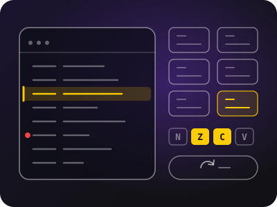
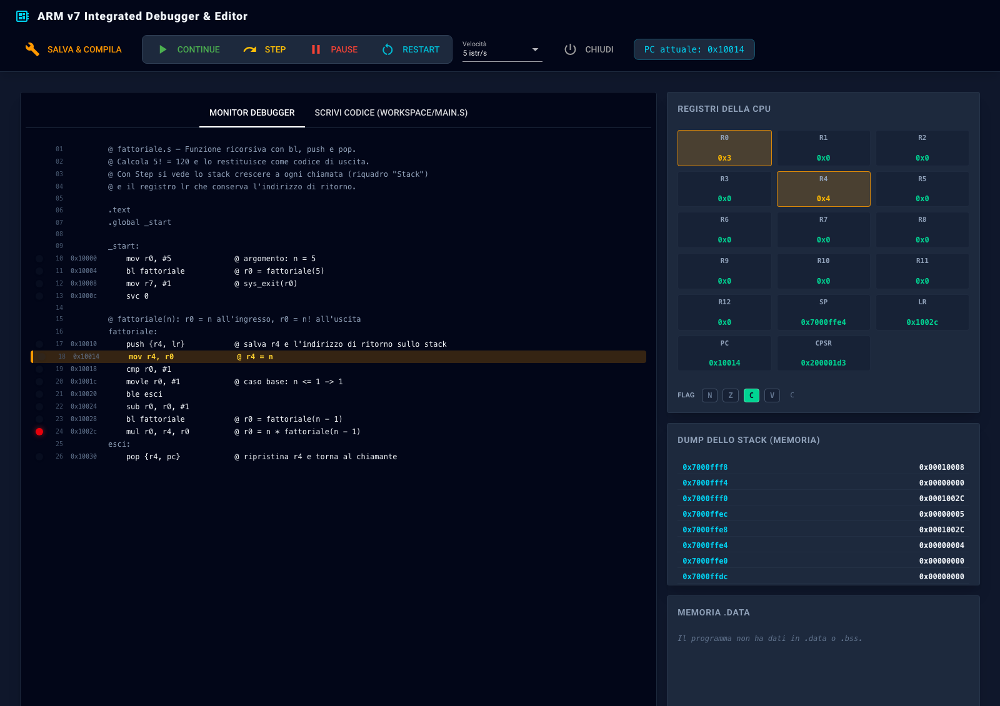
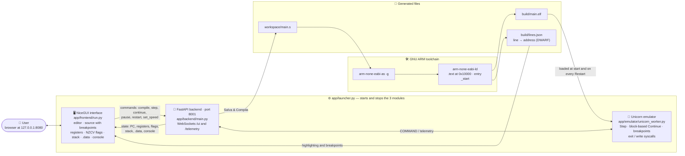

# ARM-GDK-Unicorn

🇬🇧 **English** · 🇮🇹 [Italiano](README.it.md)

<p align="center"></p>

**An educational environment to write, run and debug ARMv7 assembly programs, right in the browser.** You write code in the GNU syntax used in computer architecture courses, assemble it with the real GNU ARM toolchain and run it one instruction at a time in a CPU emulator, watching registers, flags, stack and memory change at every step.

<p align="center"></p>

> The user interface is in Italian. The button names used below (*Salva & Compila*, *Continue*, *Step*…) are the ones shown on screen.

## Features

- **Edit and build in the browser**: *Salva & Compila* (save & build) assembles the code with `arm-none-eabi-as` and `arm-none-eabi-ld` and loads it into the emulator right away. Errors show up in the console with their line number.
- **Single-step execution (Step)** and **continuous execution (Continue)** with adjustable speed, from 1 instruction per second, to follow the program line by line, up to full speed.
- **Breakpoints** with one click next to the line: execution stops *before* the marked instruction.
- **Registers** r0–r12, sp, lr, pc and cpsr, with the ones used by the current instruction highlighted.
- **N Z C V flags** of the CPSR, each with an explanation.
- **Stack** around SP and **`.data`/`.bss` memory** with the program's labels, value and ASCII characters.
- **Linux system calls** `exit` and `write`, with the program output in the console.
- **Ready-made examples** in [`examples/`](examples/): loops, arrays, recursive functions, strings and flags.
- **Runs on Windows, macOS and Linux**, checked by GitHub Actions on every change.

## Quick start

### 1. Requirements

- **Python 3.11** or later.
- **The GNU ARM toolchain**: only `arm-none-eabi-as` and `arm-none-eabi-ld` are needed.

| System  | Installing the toolchain |
| ------- | ------------------------ |
| Windows | [Arm GNU Toolchain](https://developer.arm.com/downloads/-/arm-gnu-toolchain-downloads), *arm-none-eabi* for a Windows host; during setup tick *Add path to environment variable* |
| macOS   | `brew install arm-none-eabi-binutils` |
| Linux   | `sudo apt install binutils-arm-none-eabi` (Debian, Ubuntu) or your distribution's equivalent package |

If the toolchain lives in a non-standard folder, put its `bin` folder in the `ARM_TOOLCHAIN_DIR` environment variable.

### 2. Start

```bash
./start.sh        # macOS and Linux
start.bat         # Windows
```

On first run the script creates a Python virtual environment, installs the dependencies pinned in `requirements.txt` and checks for the toolchain. If it is missing, it explains how to install it and stops. It then starts the three modules in the same window and opens the browser at <http://127.0.0.1:8080>.

### 3. Stop

Everything closes together in any of these ways:
- the **Chiudi** (close) button in the interface;
- **Ctrl+C**;
- closing the terminal window.

If one of the modules stops because of an error, the launcher stops the others too.

## How to use it

1. **Write** the program in the *Scrivi codice* (write code) tab. Until you save, **● Modifiche non salvate** (unsaved changes) is shown.
2. Press **Salva & Compila**. If the build succeeds, the program is loaded into the emulator and restarts from the beginning. Continue, Step and Restart never rebuild: they always run the last built version, and warn you if the editor has unsaved changes.
3. **Run** with *Step* or *Continue*, choosing the speed in the *Velocità* (speed) menu. *Pause* suspends, *Restart* takes the program back to the start.
4. **Watch** the current line in the *Monitor* tab, the registers, flags, stack, `.data` memory and console.

The program ends with the `exit` system call. After `exit` no other instruction runs until *Restart*.

Several browser tabs can be opened on the same debugger: they all show the same state.

## Examples

| File | What it shows | Result |
| ---- | ------------- | ------ |
| [`hello.s`](examples/hello.s) | `write` and `exit`, computed constant `len = . - msg` | prints a string |
| [`somma.s`](examples/somma.s) | counting loop, `cmp` and `ble` | `exit(55)`: sum of 1 to 10 |
| [`massimo.s`](examples/massimo.s) | `.word` array, post-increment addressing, conditional instructions (`movgt`) | `exit(42)`: largest element |
| [`fattoriale.s`](examples/fattoriale.s) | recursive function with `bl`, `push` and `pop`; the stack growing | `exit(120)`: 5! |
| [`lunghezza.s`](examples/lunghezza.s) | `.asciz` string, `ldrb`, `write` with a computed length | prints the string and exits with its length |
| [`flag.s`](examples/flag.s) | how `adds`, `subs` and `cmp` change the N Z C V flags | follow it with Step |

The examples are commented in Italian. To try one, paste it into the editor and press *Salva & Compila*. On first start the editor contains `hello.s`.

## Supported assembly

This is the GNU ARM assembler syntax (ARMv7-A, ARM mode):
- labels, also on the same line as an instruction;
- `.text`, `.data` and `.bss` sections;
- directives such as `.word`, `.byte`, `.ascii`, `.asciz`, `.space`, `.align` and `.equ`;
- constants such as `len = . - msg`;
- pseudo-instructions such as `ldr r1, =msg`;
- `@` comments.

The program starts at the `_start` label, declared with `.global _start`. Code is loaded at `0x10000`, data right after it, the stack at `0x70000000`.

| Number (`r7`) | Call         | Behaviour |
| ------------- | ------------ | --------- |
| 1             | `exit`       | ends the program with the code in `r0` |
| 4             | `write`      | writes `r2` bytes from buffer `r1` to stdout (`r0` = 1) or stderr (`r0` = 2) and returns the number of bytes written in `r0` |
| 248           | `exit_group` | same as `exit` |

Any other call returns `-ENOSYS` in `r0` and shows a warning in the console.

## Architecture

Three Python modules, started and stopped together by `app/launcher.py`, talking over WebSockets:



- **Interface** (`app/frontend/run.py`, NiceGUI): editor, source with the current line and breakpoints, registers, flags, stack, `.data` memory and console. It refreshes 10 times per second, redrawing only what changed.
- **Backend** (`app/backend/main.py`, FastAPI): serves the `/ui` WebSocket, for the interface, and `/telemetry`, for the emulator. It builds the code and routes commands and state. It only accepts connections from the local modules, not from web pages.
- **Compiler** (`app/backend/core_compiler.py`): runs `arm-none-eabi-as -g` and `arm-none-eabi-ld`, then reads the source line ↔ address mapping from the debug information (DWARF), used to highlight the current line and place breakpoints.
- **Emulator** (`app/emulator/unicorn_worker.py`, Unicorn): loads the ELF, runs one step or a block at a time, handles breakpoints and system calls and sends the state after each step, or every 50 ms during Continue.

## Project layout

```text
ARM-GDK-Unicorn/
├── start.sh / start.bat     startup (virtual environment, dependencies, toolchain, launcher)
├── requirements.txt         Python dependencies with the tested versions
├── examples/                example programs
├── app/
│   ├── launcher.py          starts the three modules and stops them together
│   ├── toolchain.py         finds the GNU ARM toolchain
│   ├── paths.py             shared paths
│   ├── backend/             FastAPI backend and compiler
│   ├── emulator/            Unicorn emulator
│   └── frontend/            NiceGUI interface
├── tests/                   automated tests
├── docs/                    README images
├── workspace/               generated: the editor's working copy (ignored by git)
└── build/                   generated: the built program (ignored by git)
```

## Tests

```bash
python -m unittest discover -s tests -v
```

The tests cover:
- building and running programs with loops, functions, strings, `.word` and computed constants;
- errors with their line number;
- every example;
- the emulator's system calls, breakpoints and speed;
- starting and stopping the full debugger.

Without the GNU toolchain the tests that need it are skipped, and the launcher test is skipped if the debugger is already running.

On every push GitHub Actions runs the same tests on Windows, macOS and Linux, with Python 3.11 and 3.13 ([`.github/workflows/tests.yml`](.github/workflows/tests.yml)).

## Options

| Environment variable | Effect |
| -------------------- | ------ |
| `ARM_TOOLCHAIN_DIR`  | `bin` folder of the GNU ARM toolchain, if it is not on the `PATH` |
| `ARM_GDK_NO_BROWSER=1` | do not open the browser at startup (automated tests) |

To check that the toolchain is found: `python -m app.toolchain`.

## License

The project's code is released under the [MIT](LICENSE) license.

The libraries it uses have their own licenses: Unicorn Engine and GNU binutils are GPL-licensed, FastAPI, NiceGUI and the other dependencies use permissive licenses. Their code is not included in this repository: the Python libraries are installed from `requirements.txt`, the GNU toolchain separately.
