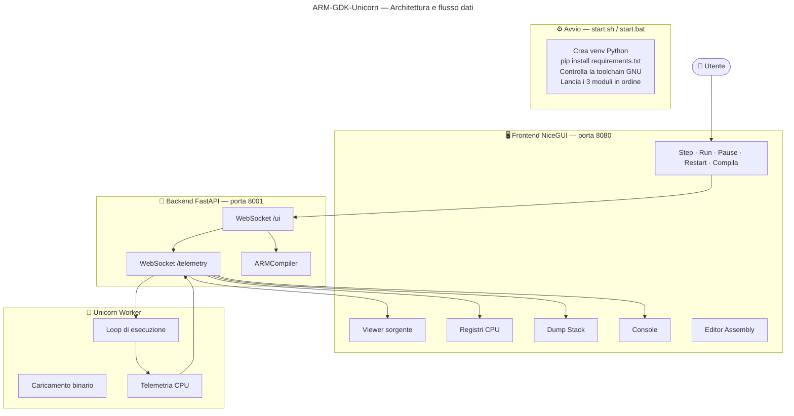

# ARM-GDK-Unicorn

ARM-GDK-Unicorn è un ambiente didattico per lo sviluppo, l'esecuzione e il debug di programmi **ARMv7 Assembly**, realizzato interamente in Python.

Il progetto combina:

* **Toolchain GNU per ARM** (`arm-none-eabi-as` e `arm-none-eabi-ld`) per assemblare e collegare il codice, con la stessa sintassi usata nei corsi;
* **Unicorn Engine** per l'emulazione della CPU ARMv7;
* **FastAPI** come hub di comunicazione;
* **NiceGUI** per l'interfaccia grafica web.

L'obiettivo è fornire una piattaforma semplice e comprensibile per studenti, docenti e appassionati di architettura dei calcolatori che desiderano osservare il comportamento interno di un processore ARM durante l'esecuzione di un programma Assembly.

---

# Caratteristiche principali

* Compilazione Assembly ARMv7 direttamente dal browser.
* Emulazione ARMv7 tramite Unicorn Engine.
* Debug passo-passo (Step).
* Esecuzione continua (Run).
* Pausa dell'esecuzione.
* Restart del programma.
* Gestione breakpoint.
* Visualizzazione registri CPU.
* Visualizzazione Stack.
* Console di output.
* Editor Assembly integrato.
* Aggiornamento dello stato in tempo reale tramite WebSocket.

---

# Architettura

Il sistema è composto da tre moduli indipendenti:

1. **Frontend NiceGUI**
2. **Backend FastAPI**
3. **Worker Unicorn**

La comunicazione avviene esclusivamente tramite WebSocket.

```text
Frontend ↔ Backend ↔ Unicorn Worker
```

## Diagramma Mermaid



---

# Struttura del progetto

```text
ARM-GDK-Unicorn/
│
├── start.sh
├── start.bat
├── requirements.txt
├── LICENSE
│
├── examples/
│   └── hello.s            programma di esempio
│
├── app/
│   ├── launcher.py        avvia i tre moduli e li chiude insieme
│   ├── toolchain.py       ricerca della toolchain GNU per ARM
│   ├── paths.py           percorsi condivisi dai tre moduli
│   │
│   ├── backend/
│   │   ├── main.py
│   │   └── core_compiler.py
│   │
│   ├── emulator/
│   │   └── unicorn_worker.py
│   │
│   └── frontend/
│       └── run.py
│
├── workspace/             generata, ignorata da git
│   └── main.s             copia di lavoro modificata dall'editor
├── build/                 generata, ignorata da git
│   └── main.bin           binario prodotto dal compilatore
└── env/
```

Al primo avvio `workspace/main.s` viene creato copiando `examples/hello.s`: l'editor modifica solo la copia di lavoro, quindi l'esempio e il repository restano puliti.

---

# Componenti

## Frontend

Percorso:

```text
app/frontend/run.py
```

Responsabilità:

* Editor Assembly
* Visualizzazione registri
* Visualizzazione stack
* Gestione breakpoint
* Console di output
* Invio comandi al backend

Porta:

```text
http://localhost:8080
```

---

## Backend

Percorso:

```text
app/backend/main.py
```

Responsabilità:

* Gestione WebSocket
* Compilazione del codice
* Smistamento dei messaggi
* Coordinamento tra GUI ed emulatore
* Accetta connessioni WebSocket solo dai moduli locali: le connessioni aperte da pagine web (header `Origin` di un browser) vengono rifiutate

Endpoint:

```text
/ws/ui
/ws/telemetry
```

---

## Compilatore ARM

Percorso:

```text
app/backend/core_compiler.py
```

Basato sulla toolchain GNU per ARM, cercata in automatico (vedi `app/toolchain.py`):

1. `arm-none-eabi-as -g` assembla `workspace/main.s` in `build/main.o`;
2. `arm-none-eabi-ld` lo collega in `build/main.elf`, con `.text` a `0x10000`, `.data` subito dopo ed entry point `_start`;
3. dalle informazioni di debug (DWARF) ricava `build/lines.json`, la corrispondenza tra righe del sorgente e indirizzi usata dall'interfaccia per evidenziare la riga corrente e posizionare i breakpoint.

La sintassi è quella dell'assembler GNU: etichette (anche sulla stessa riga dell'istruzione), sezioni `.text` e `.data`, direttive come `.word`, `.byte`, `.ascii`, `.asciz`, `.space`, `.align`, `.equ`, costanti come `len = . - msg`, pseudo-istruzioni come `ldr r1, =msg` e commenti con `@`.

Gli errori arrivano nella console dell'interfaccia con il numero di riga, ad esempio `[Compiler Errore] Riga 4: bad instruction 'bogus r1'`.

---

## Emulatore

Percorso:

```text
app/emulator/unicorn_worker.py
```

Basato su:

* Unicorn Engine

Funzionalità:

* Esecuzione ARMv7 dell'ELF prodotto dal compilatore, a partire da `_start`
* Esecuzione passo passo (Step)
* Esecuzione continua (Continue) a blocchi, con velocità regolabile dall'interfaccia: da 1 istruzione al secondo, per seguire il programma riga per riga, fino alla velocità massima
* Breakpoint: l'esecuzione si ferma *prima* di eseguire l'istruzione marcata; premendo di nuovo Continue riparte da lì
* Fine del programma: dopo `exit` (o un'eccezione della CPU, con indirizzo e motivo) non viene eseguita nessun'altra istruzione fino a Restart

Chiamate di sistema Linux supportate (numero in `r7`, argomenti in `r0`-`r2`, risultato in `r0`):

| Numero | Chiamata     | Comportamento |
| ------ | ------------ | ------------- |
| 1      | `exit`       | termina il programma con il codice in `r0` |
| 4      | `write`      | scrive il buffer `r1` di `r2` byte su stdout (`r0` = 1) o stderr (`r0` = 2), conservando spazi e tabulazioni; restituisce in `r0` il numero di byte scritti, oppure `-EBADF` per altri file descriptor |
| 248    | `exit_group` | come `exit` |

Le altre chiamate restituiscono `-ENOSYS` in `r0` e mostrano un avviso nella console.

---

# Installazione

## Requisiti

* Python 3.11 o successivo, con pip (le versioni delle librerie sono fissate in `requirements.txt`)
* La toolchain GNU per ARM: servono solo `arm-none-eabi-as` e `arm-none-eabi-ld`

| Sistema | Installazione della toolchain |
| ------- | ----------------------------- |
| Windows | [Arm GNU Toolchain](https://developer.arm.com/downloads/-/arm-gnu-toolchain-downloads), versione *arm-none-eabi* per host Windows; durante l'installazione spunta *Add path to environment variable* |
| macOS   | `brew install arm-none-eabi-binutils` |
| Linux   | `sudo apt install binutils-arm-none-eabi` (Debian, Ubuntu) oppure il pacchetto equivalente della distribuzione |

Se la toolchain è installata in una cartella non standard, indica la sua cartella `bin` nella variabile d'ambiente `ARM_TOOLCHAIN_DIR`. Per controllare che venga trovata:

```bash
python -m app.toolchain
```

---

## Dipendenze

```bash
pip install -r requirements.txt
```

Pacchetti principali:

```text
fastapi
uvicorn
nicegui
websockets
unicorn
websocket-client
pyelftools
```

---

# Avvio

## Linux / macOS

```bash
chmod +x start.sh
./start.sh
```

## Windows

```cmd
start.bat
```

Lo script:

1. crea il virtual environment;
2. installa le dipendenze e controlla la toolchain GNU (se manca, spiega come installarla e si ferma);
3. avvia con `app/launcher.py`, nella stessa finestra, il backend (atteso finché non risponde sulla porta 8001), l'emulatore e l'interfaccia, che si apre nel browser.

L'output dei tre moduli compare nella stessa finestra, con il nome del modulo davanti a ogni riga.

## Chiusura

Si chiude tutto insieme, senza processi o finestre che restano aperti:

* premendo **Chiudi** nell'interfaccia;
* con **Ctrl+C** o chiudendo la finestra del terminale;
* automaticamente, se uno dei tre moduli si ferma per un errore.

Se il debugger è già aperto, un secondo avvio si ferma subito con un messaggio invece di andare in conflitto sulle porte. Per non aprire il browser all'avvio (ad esempio nelle prove automatiche) imposta `ARM_GDK_NO_BROWSER=1`.

---

# Test

```bash
python -m unittest discover -s tests -v
```

I test compilano ed eseguono nell'emulatore una serie di programmi (cicli, funzioni, stringhe, `.word`, costanti calcolate, errori con numero di riga), provano chiamate di sistema, breakpoint e velocità dell'emulatore, e avviano e chiudono il debugger completo con il lanciatore. Se la toolchain GNU non è installata i test che ne hanno bisogno vengono saltati; il test del lanciatore viene saltato se il debugger è già aperto.

A ogni push GitHub Actions esegue gli stessi test su Windows, macOS e Linux, con Python 3.11 e 3.13 (`.github/workflows/tests.yml`).

---

# Workflow

1. Scrivere Assembly ARM nell'editor. Finché non si salva, accanto al pulsante compare **● Modifiche non salvate**.
2. Premere **Salva & Compila**: se la compilazione va a buon fine il programma viene caricato subito nell'emulatore, dall'inizio. Continue, Step e Restart non ricompilano: eseguono sempre l'ultima versione compilata (e avvisano se l'editor ha modifiche non salvate).
3. Eseguire:

   * Step
   * Continue, scegliendo la velocità nel menu *Velocità*
   * Pause
4. Analizzare:

   * registri, con il registro usato dall'istruzione corrente evidenziato;
   * flag **N Z C V** del CPSR, accesi quando valgono 1 (passando sopra con il mouse se ne legge il significato);
   * stack intorno a SP;
   * memoria **.data** (e .bss): una riga per parola, con etichetta (`msg`, `val`…), valore esadecimale e caratteri ASCII;
   * output della console.

Si possono aprire più schede del browser sullo stesso debugger: mostrano tutte lo stesso stato, e l'editor di una scheda si aggiorna quando un'altra compila (se non ha modifiche in corso).

---

# Caso d'uso didattico

ARM-GDK-Unicorn è pensato per:

* corsi di Architettura degli Elaboratori;
* Sistemi Operativi;
* Programmazione Assembly ARM;
* Reverse Engineering;
* studio delle syscall Linux ARM;
* laboratori universitari.

---

# Tecnologie utilizzate

| Tecnologia      | Ruolo                   |
| --------------- | ----------------------- |
| Python          | Linguaggio principale   |
| FastAPI         | Backend                 |
| NiceGUI         | Frontend                |
| WebSocket       | Comunicazione real-time |
| GNU binutils    | Assembler e linker ARM  |
| Unicorn Engine  | Emulatore ARM           |
| PyELFTools      | Lettura dell'ELF e delle informazioni di debug |

---

# Licenza

Il codice di questo progetto è distribuito con licenza [MIT](LICENSE).

Le librerie usate hanno licenze proprie: Unicorn Engine e le GNU binutils sono distribuite con licenza GPL, FastAPI, NiceGUI e le altre dipendenze con licenze permissive. Il repository non include il loro codice: le librerie Python vengono installate da `requirements.txt`, la toolchain GNU separatamente.
